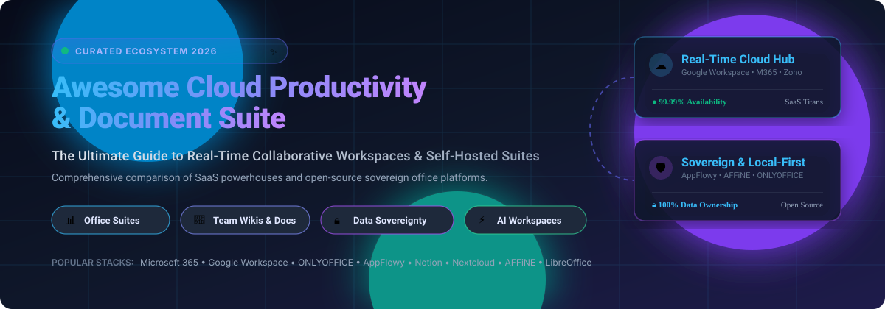
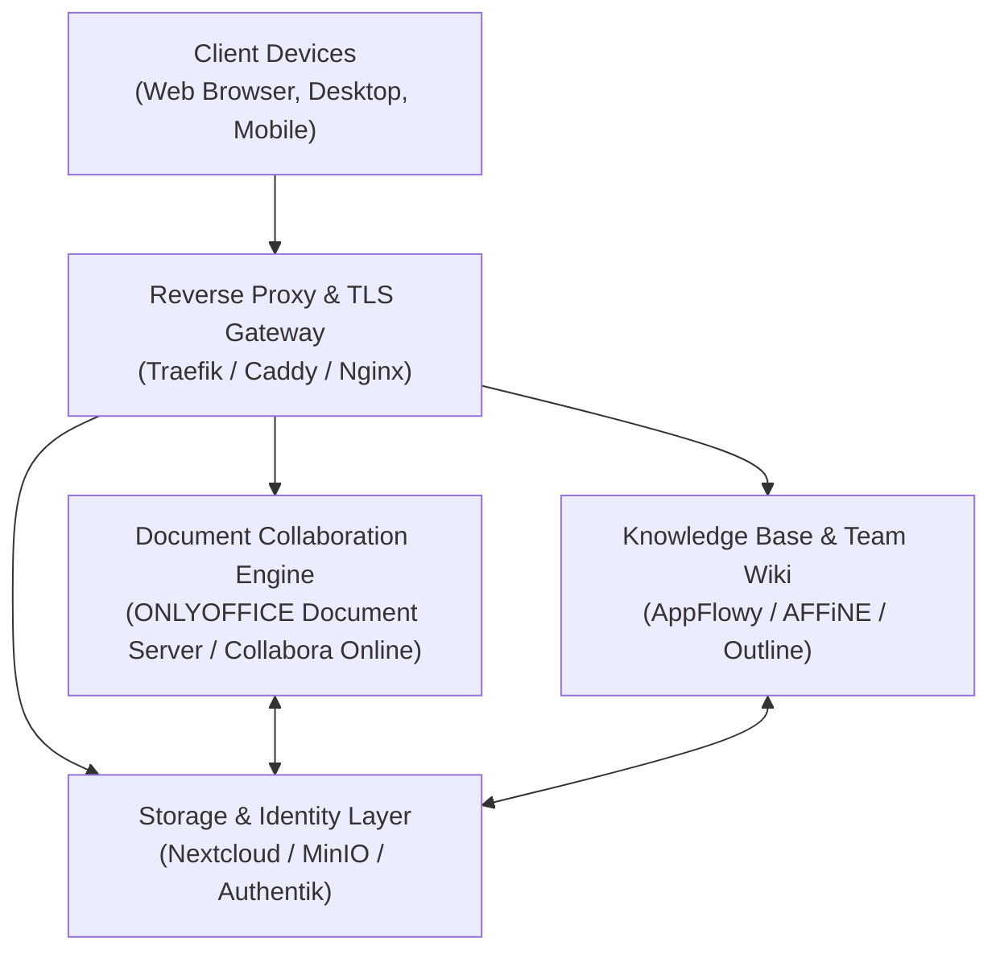

  

# 🚀 Awesome Cloud Productivity & Document Suite

  
  
  
  
  
  
  

  <strong>🌟 A curated list of leading Cloud Productivity & Document Suites, collaborative office ecosystems, team wikis, and self-hosted open-source alternatives. 🌟</strong>

  Discover and compare top SaaS productivity ecosystems (Google Workspace, Microsoft 365, Notion) and sovereign open-source collaboration platforms (AppFlowy, AFFiNE, ONLYOFFICE, LibreOffice, CryptPad) with exact pricing, free-tier limits, market valuation, and real-time GitHub metrics.

---

## 📑 Table of Contents

- [🌐 Sector Overview & Market Dynamics](#-sector-overview--market-dynamics)
- [☁️ SaaS & Hosted Productivity Suites](#️-saas--hosted-productivity-suites)
- [🛡️ Open-Source & Self-Hosted Collaboration Platforms](#️-open-source--self-hosted-collaboration-platforms)
- [🏗️ Architecture & Deployment Patterns](#️-architecture--deployment-patterns)
- [🤝 How to Contribute](#-how-to-contribute)
- [💖 Support & Sponsorship](#-support--sponsorship)
- [📊 Star History](#-star-history)
- [📜 License & Disclaimer](#-license--disclaimer)

---

## 🌐 Sector Overview & Market Dynamics

The global business and cloud office productivity software sector is projected to reach approximately **$110.36 billion in 2026** (growing at an 11% to 12% CAGR), propelled by rapid enterprise adoption of generative AI workspace assistants and hybrid workforce collaboration. 📈

The sector exhibits a **highly concentrated, winner-take-most structure** at the enterprise core—dominated by Microsoft 365 and Google Workspace, which collectively capture over 80% of enterprise seats worldwide—while remaining **moderately fragmented across specialized and open-source segments**, where modular document databases (Notion, Coda), sovereign self-hosted office suites (ONLYOFFICE, LibreOffice, Nextcloud), and privacy-first local-first platforms (AppFlowy, AFFiNE, CryptPad) flourish. 🌐✨

---

## ☁️ SaaS & Hosted Productivity Suites

*Sorted by parent company valuation / market capitalization (descending).* 🏢💼

| Product | Company Valuation / Revenue | Description | Pricing (Starting Paid Tier) | Free Tier / Trial Limits |
|:---|:---|:---|:---|:---|
| **[Apple iWork](https://www.apple.com/iwork/)** | **~$3.4 Trillion** *(Market Cap)* | 🍏 Native productivity suite for macOS, iOS, and iCloud featuring Pages, Numbers, and Keynote with real-time iCloud sync and collaboration. | **€12.99/user/month** (Creator Studio plan, or €129/year for new standalone cloud users) | **Free forever** for all Apple device owners via native apps and iCloud web (includes 5 GB free iCloud storage) |
| **[Microsoft 365](https://www.microsoft.com/en-us/microsoft-365/)** | **~$3.1 Trillion** *(Market Cap)* | 🪟 Flagship enterprise productivity suite comprising Word, Excel, PowerPoint, Outlook, Teams, OneDrive, and Copilot AI integration. | **$7.00/user/month** (Business Basic, annual commitment; $84/user/year) | **1-month (30-day) free trial** for Business Basic and Standard (up to 25 users); free web-only basic editing via personal Microsoft accounts |
| **[Google Workspace](https://workspace.google.com/)** | **~$2.1 Trillion** *(Market Cap)* | 🔍 Cloud-native collaborative workspace powering Gmail, Docs, Sheets, Slides, Drive, Meet, and Gemini AI. | **$7.00/user/month** (Business Starter, annual commitment; $84/user/year) | **14-day free trial** for Business editions; free personal Google accounts include Docs/Sheets/Slides with 15 GB shared Google Drive storage |
| **[Quip](https://quip.com/)** | **~$190 Billion** *(Salesforce Market Cap)* | ⚡ Salesforce-native collaborative document and spreadsheet workspace combining integrated team chat, live Salesforce data embeds, and mobile authoring. | **$10.00/user/month** (Starter, annual commitment; or $12.00 billed monthly) | **30-day free trial** with access to Starter features; no permanent free tier |
| **[WPS Cloud](https://www.wps.com/)** | **~$15 Billion** *(Market Cap, Beijing Kingsoft Office)* | 📄 Comprehensive multi-platform office suite with Writer, Spreadsheets, Presentation, robust PDF editor, and cloud templates. | **$3.99/user/month** (WPS Pro, billed annually at ~$35.99/year) | **Free forever** (WPS Standard): includes core office editors, PDF viewer/annotation, basic templates, and 1 GB cloud storage; 7-day free trial for Pro features |
| **[Zoho Workplace](https://www.zoho.com/workplace/)** | **~$12.5 Billion** *(Private Valuation, ₹12,300+ Cr Revenue)* | 💼 Bootstrapped all-in-one business productivity ecosystem with Writer, Sheet, Show, WorkDrive, Mail, Cliq chat, and Meeting. | **$3.00/user/month** (Standard plan billed annually; or ¥150/user/year in regional pricing) | **15-day free trial** for Workplace suite (up to 25 users); free forever Zoho Mail plan available for up to 5 users with 5 GB/user storage |
| **[Notion](https://www.notion.so/)** | **~$11 Billion** *(Private Valuation, $860M+ ARR)* | 🧠 Connected modular workspace uniting documents, relational databases, team wikis, project roadmaps, and embedded AI agents. | **$10.00/user/month** (Plus plan, annual commitment; or $12.00 billed monthly) | **Free forever** plan for individuals and small teams: unlimited pages/blocks, up to 10 guest collaborators, 5 MB file upload limit, and 7-day page history |
| **[Dropbox Paper](https://www.dropbox.com/paper)** | **~$7.8 Billion** *(Dropbox Market Cap, $2.5B ARR)* | 📦 Real-time collaborative workspace and markdown-enabled doc editor integrated directly into Dropbox cloud file storage. | **$9.99/user/month** (Dropbox Plus starting storage plan; Paper tool itself is included) | **Free forever**: unlimited Paper docs and real-time editing with any free 2 GB Dropbox Basic account |
| **[Coda](https://coda.io/)** | **~$1.4 Billion** *(Acquired by Superhuman / Grammarly)* | 🧩 Dynamic all-in-one document and application builder featuring relational tables, custom automations, interactive buttons, and formula packs. | **$10.00/month per Doc Maker** (Pro tier, annual commitment; Editors & Viewers are free) | **Free forever** plan: unlimited unshared docs, unlimited editors/viewers, 50 objects per doc, 1 GB total storage, and 7-day version history |
| **[ONLYOFFICE](https://www.onlyoffice.com/)** | **~$12 Million ARR** *(Privately held, Ascensio System SIA)* | 🏢 Office Open XML-compliant document suite with Docs, Sheets, Slides, PDF form builder, and DocSpace collaboration rooms. | **$5.00/user/month** (DocSpace Business cloud plan; or quote-based perpetual on-premise license) | **Free forever** (Startup Cloud plan): up to 3 admins, unlimited regular users/visitors, 12 collaboration rooms, 2 GB cloud storage, and community support |

---

## 🛡️ Open-Source & Self-Hosted Collaboration Platforms

*Sorted by GitHub Star count (descending).* 🌟⭐

| Project | Star Badge | Description | Primary Capabilities |
|:---|:---:|:---|:---|
| **[AppFlowy](https://github.com/AppFlowy-IO/AppFlowy)** |  | 🪶 The leading open-source alternative to Notion, built with Flutter and Rust. Prioritizes data security, offline-first operation, modular plugins, and native AI capabilities. | Kanban, Team Wikis, Relational Tables, Offline-first, AI Agents |
| **[AFFiNE](https://github.com/toeverything/AFFiNE)** |  | 🎨 Next-generation all-in-one workspace uniting docs, whiteboards, mind maps, and relational databases. Seamlessly toggles between structured text documents and infinite canvas boards. | Infinite Canvas, Markdown Docs, Whiteboards, Self-hostable, Local-first |
| **[NocoDB](https://github.com/nocodb/nocodb)** |  | 🔥 Open-source no-code relational database and smart spreadsheet platform that transforms any SQL database into a collaborative Airtable-style workspace. | Smart Spreadsheets, Relational Grids, REST APIs, Gallery/Kanban views |
| **[Logseq](https://github.com/logseq/logseq)** |  | 🕸️ Privacy-first, local-first knowledge management and outliner platform supporting Markdown and Org-mode with bi-directional linking and flashcards. | Outliner, Bidirectional Linking, Knowledge Graph, Whiteboards, Local files |
| **[Outline](https://github.com/outline/outline)** |  | ⚡ Blazing-fast, modern team knowledge base and wiki built with React and Node.js. Beautiful UI with real-time markdown collaboration, permissions, and Slack integration. | Team Wiki, Real-Time Markdown, Structured Hierarchy, Fast Search |
| **[Etherpad](https://github.com/ether/etherpad-lite)** |  | 📝 Highly customizable, real-time collaborative rich-text editor engine powering web pads with infinite version history and extensive plugin ecosystem. | Real-time Typing Sync, Time Slider History, Rich Plugins, Embeddable API |
| **[CryptPad](https://github.com/cryptpad/cryptpad)** |  | 🔐 Zero-knowledge, end-to-end encrypted collaboration suite featuring rich text, spreadsheets, presentations, code pads, forms, and kanban boards. | End-to-End Encryption, Zero-Knowledge Storage, Collaborative Docs & Sheets |
| **[ONLYOFFICE Document Server](https://github.com/ONLYOFFICE/DocumentServer)** |  | 📑 Enterprise-grade self-hosted collaborative document engine with native support for OOXML (`.docx`, `.xlsx`, `.pptx`). Integrates with Nextcloud, ownCloud, and custom platforms. | Word, Spreadsheet & Presentation Editors, Track Changes, Real-time Co-editing |
| **[LibreOffice](https://github.com/LibreOffice/core)** |  | 📚 The gold standard open-source desktop office suite from The Document Foundation. Delivers Writer, Calc, Impress, Draw, Base, and Math with comprehensive file format support. | Desktop Office Suite, OpenDocument Format (ODF), Offline Authoring, Zero Telemetry |
| **[Collabora Online](https://github.com/CollaboraOnline/online)** |  | 🌐 Powerful LibreOffice-based cloud office suite providing high-fidelity document viewing and collaborative editing for Nextcloud, ownCloud, and enterprise web solutions. | LibreOffice Engine in Cloud, WOPI Integration, Multi-user Editing, High Fidelity |
| **[Nextcloud Office](https://github.com/nextcloud/richdocuments)** |  | ☁️ Official Nextcloud integration app connecting Collabora Online and ONLYOFFICE to provide fully sovereign cloud document workflows within private Nextcloud instances. | Self-hosted Cloud Storage, File Sharing, Live Document Editing, Sovereign Hosting |
| **[Folio](https://github.com/evergreen-it-dev/folio)** |  | 🤖 Git-native, AI-assisted team wiki and knowledge base designed as an open-source alternative to Notion and Confluence with real-time editing and offline mode. | Git-backed Storage, AI Assistant, Whiteboards, Data Tables, Markdown |

---

## 🏗️ Architecture & Deployment Patterns

Self-hosting a resilient cloud productivity stack provides enterprise data sovereignty, regulatory compliance (GDPR, HIPAA), and immunity against per-seat SaaS price hikes: 🛡️⚙️

### 💡 Recommended Self-Hosted Stacks

- 🏢 **Full Office Suite Replacement:** Deploy **Nextcloud Hub** + **ONLYOFFICE Document Server** or **Collabora Online** using Docker Compose for complete drop-in parity with Microsoft 365 or Google Workspace.
- 🧠 **Modern Knowledge Workspace:** Deploy **AFFiNE** or **AppFlowy Cloud** alongside **Outline** for real-time team wikis, relational databases, and visual whiteboards.
- 🔒 **Maximum Privacy & Compliance:** Deploy **CryptPad** with client-side end-to-end encryption, ensuring zero server-side plaintext exposure.

---

## 🤝 How to Contribute

Contributions, corrections, and new entries are warmly welcome! 🙌

1. 🍴 Fork the repository.
2. 🌿 Create a descriptive branch (`git checkout -b feature/add-new-suite`).
3. ✍️ Add or update entries following the table format (ensure exact pricing, verified free tiers, company valuation, and star badges are included).
4. 💾 Commit your changes (`git commit -m "Add New Productivity Suite"`).
5. 🚀 Push to the branch (`git push origin feature/add-new-suite`) and open a Pull Request.

---

## 💖 Support & Sponsorship

If you find this curated ecosystem tracker helpful, please consider supporting the project! ☕✨

- ⭐ **Star this repository** to help others discover it!
- 🍴 **Fork and contribute** your favorite productivity tools.
- 📢 **Share** with your friends, colleagues, and developer communities.
- ☕ **Buy me a coffee**: Support ongoing maintenance and research via the [GitHub Sponsors Dashboard](https://github.com/sponsors/ishandutta2007)!

  

---

## 📊 Star History

---

## 📜 License & Disclaimer

- Distributed under the [MIT License](LICENSE). 📄
- All product names, logos, and brands are property of their respective owners. Pricing, free-tier limits, and market capitalizations reflect publicly reported data and vendor terms as of 2026. Verify directly on vendor websites before procurement. ⚖️
